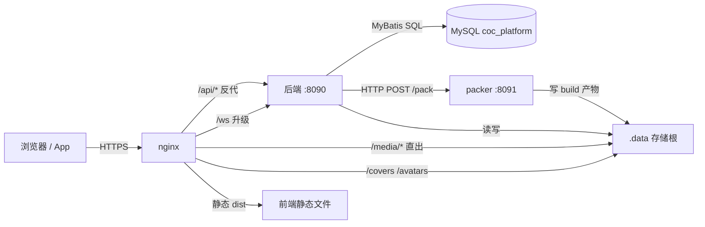
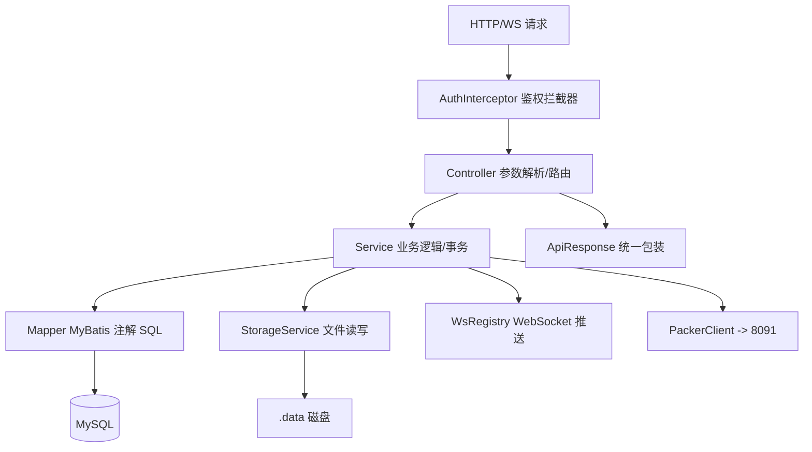
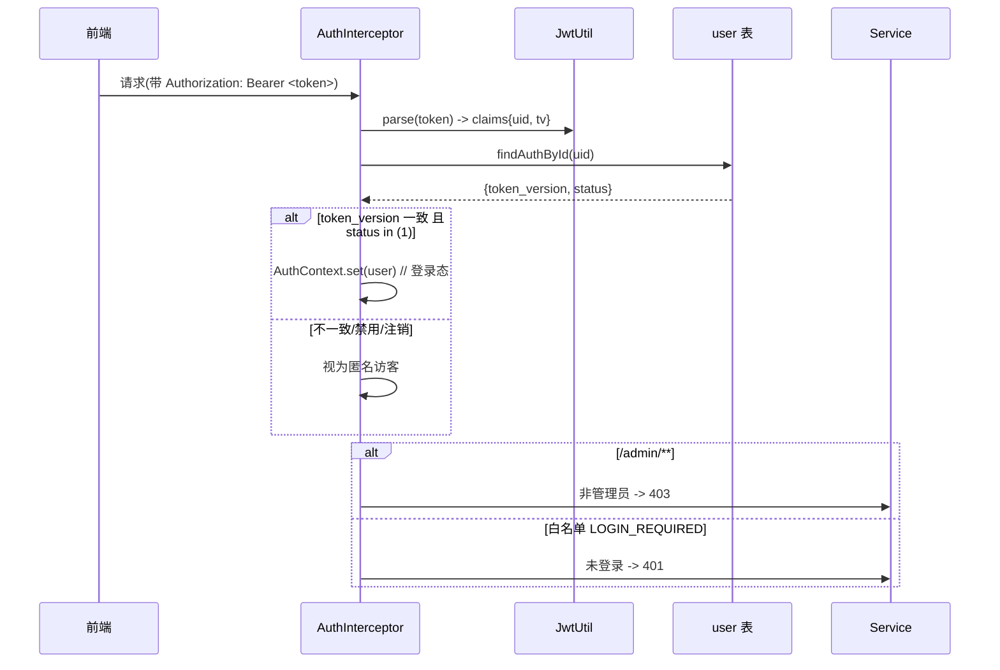
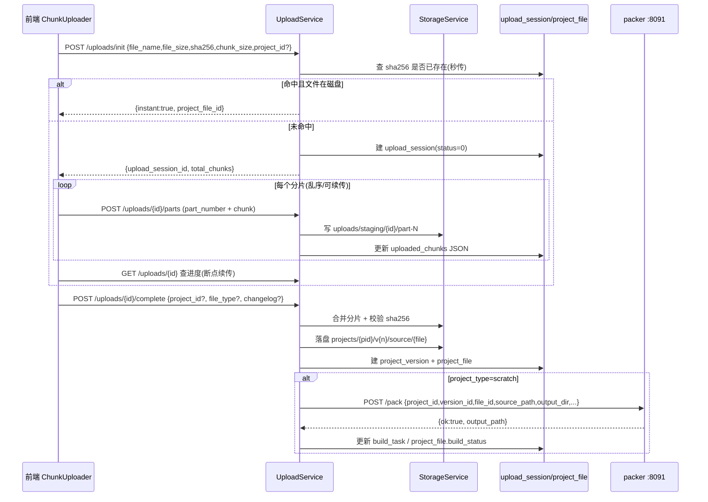
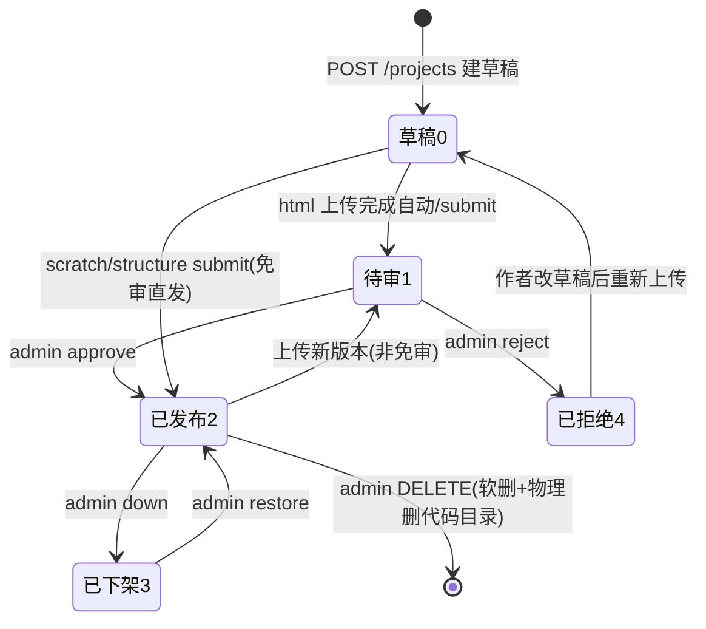
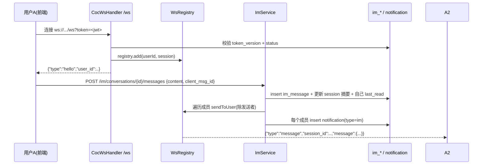

# 造物集（coc-platform）数据流向文档

> 目的：从「数据从哪里来、经过哪些组件、落到哪里、又怎么被读出去」的视角，梳理本项目端到端的数据流。
> 覆盖范围：前端（`frontend` / `frontend-app`）→ nginx → 后端（`backend`，Spring Boot）→ MySQL，以及 `packer`（打包服务）与文件存储（`.data`）。
> 约定：本文与 `contract/api-mvp.md`、`DEPLOY.md`、`backend/README-dev.md` 口径一致，冲突时以契约为准。

---

## 1. 系统总览

单仓多模块，六块组成一条完整链路：

| 组件 | 技术栈 | 端口/位置 | 职责 |
| --- | --- | --- | --- |
| `frontend` | Vue3 + Vite + Element Plus + Pinia | dev 8085（主站）/ 8086（用户内容区） | 用户界面，构建后交给 nginx 静态托管 |
| `frontend-app` | 同上 + Capacitor | 原生壳 | 移动端 App，同代码库、同接口 |
| `backend` | Java 21 + Spring Boot 3.5.16 + MyBatis + Flyway | 8090 | 业务逻辑、鉴权、WebSocket |
| `packer` | Node + `@turbowarp/packager` | 8091 | sb2/sb3 → 单文件 HTML |
| MySQL | 8.0+ | 3306 | 数据库 `coc_platform`（utf8mb4 / InnoDB） |
| nginx + cloudflared | — | 域名入口 | 反代 `/api` `/ws`，静态托管，沙箱子域 |

**数据在组件间的总体走向：**



- **前端与后端**：前端通过 axios 以同源 `/api/v1`（或原生壳回落到线上绝对地址）访问后端；WebSocket 走 `/ws?token=`。
- **统一响应包装**：所有接口返回 `{"code":0,"message":"ok","data":{...}}`，出错 `code!=0` + `message`，HTTP 状态码尽量语义化（401/403/404）。

---

## 2. 后端分层与请求主链路

后端代码按 `controller → service → mapper` 分层，数据流固定如下：



- **`controller`**：`AuthController`、`ProjectController`、`UploadController`、`AssetController`、`SeriesController`、`InteractionController`、`MetaController`、`FileController`、`ImController`、`AdminController`、`UserController` 等，只做参数接收与结果包装。
- **`service`**：承载事务（`@Transactional`）与业务规则，是数据流转的核心；`UploadService`、`ProjectService`、`AssetService`、`SeriesService`、`ImService`、`InteractionService`、`AuthService`、`ReportService`、`AdminService`、`FileService` 等。
- **`mapper`**：MyBatis 注解 SQL，直接操作 MySQL；实体以 `Map<String,Object>` 传递（`map-underscore-to-camel-case` 开启）。
- **`AuthContext`**：`ThreadLocal` 保存当前登录用户，`AuthInterceptor` 在 `afterCompletion` 清理。

---

## 3. 认证与鉴权数据流（JWT）

身份三态：**匿名访客**（不写库、无账号行）⊂ **开发者**（`user.type=2`）⊂ **管理员**（`user.type=3`）。



关键点：

- **JWT**：HS256（jjwt 0.12.6），payload 含 `sub`(user_id) 与 `tv`(token_version)，有效期 168h。
- **`token_version` 换发失效**：改密/管理员重置密码/注销时 `token_version+1`，旧 token 因 `tv` 不匹配立即失效。
- **密码**：BCrypt 单向哈希（仅 `spring-security-crypto`，不引完整 Spring Security）。
- **登录接口** `POST /auth/login`：仅 `status=1` 可登录；`0` 审核中 / `2` 禁用 / `3` 已注销 均 403。
- **访客规则**：只读内容（列表/详情/运行/统计/评论查看）；评论/点赞/收藏/举报/下载/私信/投稿一律 401。
- **token 提取优先级**：`Authorization: Bearer` → `token` header → `token` query（WS 握手与下载链接用 query）。

---

## 4. 投稿与文件上传数据流（分片 + 秒传 + 打包）

这是最重的一条链路，核心是「三阶段分片上传」，项目源码与素材共用同一套协议。

### 4.1 分片上传协议（`UploadService` + `AssetService`）



### 4.2 关键环节

- **秒传（sha256 去重）**：`init` 时按 `sha256` 查 `project_file`，命中且磁盘文件仍存在则 `instant=true`，直接返回已有 `project_file_id`，跳过上传；命中但文件已失效则静默回退为普通上传。
- **分片暂存**：`uploads/staging/{session_id}/part-N`（`part-N.tmp` → 原子 rename），支持乱序、断点续传。
- **合并与校验**：`complete` 时按 1..N 顺序合并到 `uploads/tmp/{sessionId}_{fileName}`，再算 sha256 与客户端比对，不一致报 `1005`。
- **落盘与登记**：复制/移动到 `projects/{project_id}/v{n}/source/`，建 `project_version`（版本号 `maxVersionNo+1`）与 `project_file`（`file_type=source`，`scan_status` 恒为 1）。
- **html zip 解压**：`file_name` 以 `.zip` 结尾的 html 项目，落盘后解压到 source 目录（剥一层根目录、防目录穿越）。
- **触发打包**：`scratch` 类型在 complete 时同步 HTTP 调 `http://127.0.0.1:8091/pack`（超时 4s）。8091 不可用时**优雅降级**：写 `build_task(status=0)` 并返回成功，可调 `/build/retry` 重试。
- **自动回退待审**：已发布项目上传新版本且非免审类型 → 状态回退为待审；html 项目上传完成即自动 `submitForReview`（status 0/4 → 1）。

### 4.3 素材上传（`AssetService`，V4 新增）

复用同一分片协议，区别只在 `kind` 与落盘：

- `init` 建 `upload_session(kind=asset)`，扩展名白名单（图片/gif/视频/音频/json），单文件 ≤300MB。
- `complete` 落到 `assets/{assetId}/{fileName}`，登记 `asset` 表，`storage_path = assets/{assetId}/{fileName}`。
- **直链**：`/media/{assetId}/{fileName}`，由 nginx 直接 alias 到存储目录，纯静态、可直接写进用户 HTML；「公开性」只控制是否出现在素材广场，不阻止已知直链访问。

---

## 5. 项目生命周期数据流

项目状态：`0 草稿 / 1 待审 / 2 已发布 / 3 已下架 / 4 已拒绝`，删除用 `is_deleted=1`。



- `audit_mode`：`html`=`manual`（需人工审核）；`scratch`/`structure`=`auto`（免审直发 2）。
- `submit`（`ProjectService.submit`）：免审类型 `publishProject` + `ensureProjectGroup`（建项目群，作者入群）；否则 `submitForReview`。
- **发布时建项目群**：`im_session(kind=2, project_id)`，作者先入群。
- 审核通过/驳回/下架/删除均写 `project_review` 与 `notification`（通知作者）。

---

## 6. 浏览与统计数据流

- `POST /projects/{id}/view`（访客可调，无用户维度、无防刷）：`project_view_daily` + `project_view_hourly` 各 +1，`project.view_count_total` +1。
- `GET /projects/{id}/stats?range=`：**动态读表计算**折线，不存快照：
  - `range=2` → 走 `project_view_hourly`，近 48 小时逐点；
  - `7/15/30` → 走 `project_view_daily`；
  - 评论数在 SQL 里按天/小时动态 `count`。
- 首页作品流/排行是读多写少场景，用 `HotCache`（进程内 20s 内存缓存，key `projects:*`），投稿/审核/删除/改封面时 `invalidate`。

---

## 7. 互动数据流（评论 / 点赞 / 收藏 / 关注 / 举报）

均要求登录，且多为「开关切换」语义（幂等）：

| 接口 | 写库 | 副作用 |
| --- | --- | --- |
| `POST /comments` | `comment`（`root_comment_id`/`parent_comment_id` 楼中楼一层） | 已发布项目才可评论；作者发言 `is_author:true` |
| `POST /comments/{id}/like` | `comment_like`（唯一键 comment+user） | 回写 `comment.like_count` |
| `POST /projects/{id}/like` | `project_like` | 回写 `project.like_count` |
| `POST /projects/{id}/favorite` | `project_favorite` | 回写 `project.favorite_count` |
| `POST /users/{id}/follow` | `follow`（唯一键 follower+followee） | — |
| `POST /reports` | `report`（target_type: project/comment/user） | 处理成立后写 `notification` + 给举报人 `user.reward_points` 加分 |

评论树读取（`GET /projects/{id}/comments`）：根评论分页 + `replies`（楼中楼固定一层）。

---

## 8. IM 与 WebSocket 数据流



- **连接**：`/ws?token=`，token 无效/状态非正常 → `close 4001`。
- **协议**：客户端发 `{"type":"hello"}` / `{"type":"ping"}`；服务端回 `hello` / `pong` / 推送 `message`。
- **消息落库**：`im_message`（含 `client_msg_id` 幂等去重、`content_type` 文本/图片/文件），`im_session_member.last_read_message_id` 记已读。
- **游标分页**：消息列表每页 20 条，`im_message_id` 作游标，返回 `next_cursor`。
- **双形态会话**：`im_session.kind=1` 单聊 / `2` 项目群（发布时自动建群）。
- **未读**：实时子查询 `unread_count`（MVP 够用，量大需缓存）。

---

## 9. 系列数据流（V4 新增）

- 两类独立系列：`project_series`（只装项目）、`asset_series`（只装素材），各带 `is_public`。
- 项目归属系列：`project.series_id`（可空，删系列 `ON DELETE SET NULL`，项目不丢）；素材归属：`asset.series_id`。
- 建草稿/上传素材时可传 `series_id` 或 `new_series_name` 就近建系列（`SeriesService.ensureByName`），且**必须属于当前用户**，否则 403。
- 详情页做「系列导航」：读同系列其他项目，未发布项目只对作者/管理员可见。

---

## 10. 管理端数据流（`/api/v1/admin/**`，一律要求 `type=3`）

- 所有管理员操作写 `operation_log`（审计：动作、对象、详情、IP）。
- 关键写操作：审核 approve/reject、下架 down/restore、删除（软删 + **物理删代码目录** + 审计）、删评论、开发者申请审批、举报处理（resolve/reject + 通知 + 加分）、找回密码生成一次性临时密码、注销账号（status=3，作品保留、作者名回退「用户已注销」）、Bug 反馈受理。
- `GET /admin/projects/{id}/storage` 返回**服务器绝对存储路径**（仅管理员，写审计 `view_storage`）。

---

## 11. 文件存储目录结构（`coc.storage.root`）

```
.data/
  projects/{project_id}/v{n}/source/   # 源码（html 的 zip 解压到这里，沙箱运行）
  projects/{project_id}/v{n}/build/    # 打包产物（8091 写入 index.html）
  assets/{asset_id}/{file_name}        # 素材（/media/ 直出）
  covers/                              # 封面（/covers/ 直出，p{项目id}-{时间戳}.{ext}）
  avatars/                             # 头像（/avatars/ 直出）
  uploads/tmp/                         # 合并后的临时文件
  uploads/staging/{session_id}/        # 分片 part-1..N
  agreements/                          # 协议内容
```

- 存储路径入库：`project_file.storage_path` 存绝对路径；`asset.storage_path` 存相对路径（`assets/{id}/{file}`）；`StorageService.resolveStored` 兼容两者。
- **沙箱运行**：`GET /run/{project_id}/**` 公开只读，优先 `build` 否则 `source`，防目录穿越；iframe `sandbox="allow-scripts"`（**不加 allow-same-origin**）。

---

## 12. 纯数据库 ER 图

### 12.1 表清单（Flyway 迁移，共 30 张）

| 迁移 | 表 |
| --- | --- |
| `V1__init.sql` | 26 张核心业务表：`user`、`developer_profile`、`category`、`tag`、`project`、`project_tag`、`project_version`、`project_file`、`project_review`、`comment`、`comment_like`、`project_like`、`project_favorite`、`project_view_daily`、`project_view_hourly`、`report`、`follow`、`im_session`、`im_message`、`im_session_member`、`notification`、`operation_log`、`upload_session`、`build_task`、`password_reset_apply`、`agreement_version` |
| `V2__password_reset_reject.sql` | 修改 `password_reset_apply`（新增 `reject_reason`，status 0/1/2） |
| `V3__bug_feedback.sql` | 新增 `bug_feedback` |
| `V4__assets_and_series.sql` | 新增 `project_series`、`asset_series`、`asset`；`project` 增 `series_id`；`upload_session` 增 `kind` |

### 12.2 完整 ER 图（依据真实外键约束）

> 说明：`PK`=主键、`UK`=唯一键、`FK`=外键。关系线只画**实际声明的外键**（`FOREIGN KEY ... REFERENCES`），
> 逻辑引用但未声明外键的字段（如 `comment.parent_comment_id` 自引用、`operation_log.admin_id`、
> `password_reset_apply.handled_by`、`report.target_id` 多态、`im_session.user_a_id/user_b_id`、
> `upload_session.project_id`）在 12.3 单独列出。

```mermaid
erDiagram
  user {
    bigint user_id PK
    varchar qq_account UK
    varchar password_hash
    varchar nickname
    tinyint type
    tinyint status
    int token_version
    int reward_points
  }
  developer_profile {
    bigint developer_profile_id PK
    bigint user_id FK
    bigint reviewer_id FK
    tinyint apply_status
    int contribution_value
  }
  category {
    bigint category_id PK
    varchar slug UK
    tinyint status
  }
  tag {
    bigint tag_id PK
    varchar name UK
  }
  project {
    bigint project_id PK
    bigint author_id FK
    enum project_type
    bigint category_id FK
    bigint series_id FK
    tinyint status
    enum audit_mode
    tinyint is_deleted
    bigint view_count_total
  }
  project_tag {
    bigint project_tag_id PK
    bigint project_id FK
    bigint tag_id FK
  }
  project_version {
    bigint project_version_id PK
    bigint project_id FK
    int version_no
    bigint created_by FK
  }
  project_file {
    bigint project_file_id PK
    bigint project_version_id FK
    enum file_type
    char sha256
    tinyint build_status
  }
  project_review {
    bigint project_review_id PK
    bigint project_version_id FK
    bigint admin_id FK
    enum action
  }
  comment {
    bigint comment_id PK
    bigint project_id FK
    bigint user_id FK
    bigint parent_comment_id
    bigint root_comment_id
    tinyint is_deleted
  }
  comment_like {
    bigint comment_like_id PK
    bigint comment_id FK
    bigint user_id FK
  }
  project_like {
    bigint project_like_id PK
    bigint project_id FK
    bigint user_id FK
  }
  project_favorite {
    bigint project_favorite_id PK
    bigint project_id FK
    bigint user_id FK
  }
  project_view_daily {
    bigint project_id PK
    date stat_date PK
    int view_count
  }
  project_view_hourly {
    bigint project_id PK
    datetime stat_hour PK
    int view_count
  }
  report {
    bigint report_id PK
    bigint reporter_id FK
    enum target_type
    bigint target_id
    bigint handler_id FK
    tinyint status
    int reward_points
  }
  follow {
    bigint follow_id PK
    bigint follower_id FK
    bigint followee_id FK
  }
  im_session {
    bigint im_session_id PK
    tinyint kind
    bigint project_id FK
    bigint user_a_id
    bigint user_b_id
  }
  im_message {
    bigint im_message_id PK
    bigint session_id FK
    bigint sender_id FK
    tinyint content_type
    varchar client_msg_id
  }
  im_session_member {
    bigint im_session_member_id PK
    bigint session_id FK
    bigint user_id FK
    bigint last_read_message_id
  }
  notification {
    bigint notification_id PK
    bigint user_id FK
    varchar type
    tinyint is_read
  }
  operation_log {
    bigint log_id PK
    bigint admin_id
    varchar action
  }
  upload_session {
    bigint upload_session_id PK
    bigint user_id FK
    bigint project_id
    enum kind
    char sha256
    tinyint status
  }
  build_task {
    bigint build_task_id PK
    bigint project_file_id FK
    tinyint status
  }
  password_reset_apply {
    bigint apply_id PK
    varchar qq_account
    bigint handled_by
    tinyint status
  }
  agreement_version {
    bigint agreement_version_id PK
    varchar version_no UK
    tinyint is_current
  }
  bug_feedback {
    bigint bug_id PK
    bigint user_id FK
    tinyint status
  }
  project_series {
    bigint series_id PK
    bigint user_id FK
    tinyint is_public
  }
  asset_series {
    bigint series_id PK
    bigint user_id FK
    tinyint is_public
  }
  asset {
    bigint asset_id PK
    bigint user_id FK
    bigint series_id FK
    enum asset_type
    char sha256
    tinyint is_public
    tinyint is_deleted
  }

  %% ===== 外键关系 =====
  user ||--o{ developer_profile : "user_id"
  user ||--o{ developer_profile : "reviewer_id"
  user ||--o{ project : "author_id"
  user ||--o{ project_version : "created_by"
  user ||--o{ project_review : "admin_id"
  user ||--o{ comment : "user_id"
  user ||--o{ comment_like : "user_id"
  user ||--o{ project_like : "user_id"
  user ||--o{ project_favorite : "user_id"
  user ||--o{ report : "reporter_id"
  user ||--o{ report : "handler_id"
  user ||--o{ follow : "follower_id"
  user ||--o{ follow : "followee_id"
  user ||--o{ im_message : "sender_id"
  user ||--o{ im_session_member : "user_id"
  user ||--o{ notification : "user_id"
  user ||--o{ upload_session : "user_id"
  user ||--o{ bug_feedback : "user_id"
  user ||--o{ project_series : "user_id"
  user ||--o{ asset_series : "user_id"
  user ||--o{ asset : "user_id"

  category ||--o{ project : "category_id"
  tag ||--o{ project_tag : "tag_id"

  project ||--o{ project_tag : "project_id"
  project ||--o{ project_version : "project_id"
  project ||--o{ comment : "project_id"
  project ||--o{ project_like : "project_id"
  project ||--o{ project_favorite : "project_id"
  project ||--o{ project_view_daily : "project_id"
  project ||--o{ project_view_hourly : "project_id"
  project ||--o{ im_session : "project_id"
  project_series ||--o{ project : "series_id"

  project_version ||--o{ project_file : "project_version_id"
  project_version ||--o{ project_review : "project_version_id"
  project_file ||--o{ build_task : "project_file_id"

  comment ||--o{ comment_like : "comment_id"
  im_session ||--o{ im_message : "session_id"
  im_session ||--o{ im_session_member : "session_id"
  asset_series ||--o{ asset : "series_id"
```



### 12.3 外键汇总表

| 外键字段 | 引用 | 删除策略 |
| --- | --- | --- |
| `developer_profile.user_id` | `user.user_id` | CASCADE |
| `developer_profile.reviewer_id` | `user.user_id` | SET NULL |
| `project.author_id` | `user.user_id` | RESTRICT |
| `project.category_id` | `category.category_id` | SET NULL |
| `project.series_id` | `project_series.series_id` | SET NULL |
| `project_tag.project_id` / `tag_id` | `project` / `tag` | CASCADE |
| `project_version.project_id` | `project.project_id` | CASCADE |
| `project_version.created_by` | `user.user_id` | RESTRICT |
| `project_file.project_version_id` | `project_version.project_version_id` | CASCADE |
| `project_review.project_version_id` | `project_version.project_version_id` | CASCADE |
| `project_review.admin_id` | `user.user_id` | RESTRICT |
| `comment.project_id` | `project.project_id` | CASCADE |
| `comment.user_id` | `user.user_id` | RESTRICT |
| `comment_like.comment_id` / `user_id` | `comment` / `user` | CASCADE |
| `project_like.project_id` / `user_id` | `project` / `user` | CASCADE |
| `project_favorite.project_id` / `user_id` | `project` / `user` | CASCADE |
| `project_view_daily.project_id` | `project.project_id` | CASCADE |
| `project_view_hourly.project_id` | `project.project_id` | CASCADE |
| `report.reporter_id` | `user.user_id` | CASCADE |
| `report.handler_id` | `user.user_id` | SET NULL |
| `follow.follower_id` / `followee_id` | `user.user_id` | CASCADE |
| `im_session.project_id` | `project.project_id` | CASCADE |
| `im_message.session_id` | `im_session.im_session_id` | CASCADE |
| `im_message.sender_id` | `user.user_id` | CASCADE |
| `im_session_member.session_id` | `im_session.im_session_id` | CASCADE |
| `im_session_member.user_id` | `user.user_id` | CASCADE |
| `notification.user_id` | `user.user_id` | CASCADE |
| `upload_session.user_id` | `user.user_id` | CASCADE |
| `build_task.project_file_id` | `project_file.project_file_id` | CASCADE |
| `bug_feedback.user_id` | `user.user_id` | CASCADE |
| `project_series.user_id` | `user.user_id` | CASCADE |
| `asset_series.user_id` | `user.user_id` | CASCADE |
| `asset.user_id` | `user.user_id` | CASCADE |
| `asset.series_id` | `asset_series.series_id` | SET NULL |

### 12.4 逻辑引用（未声明外键，业务层面关联）

| 字段 | 指向 | 说明 |
| --- | --- | --- |
| `comment.parent_comment_id` / `root_comment_id` | `comment.comment_id` | 楼中楼一层，自引用，未加外键 |
| `operation_log.admin_id` | `user.user_id` | 审计操作人（含登录下载者），未加外键 |
| `password_reset_apply.handled_by` | `user.user_id` | 处理管理员，未加外键 |
| `report.target_id` | 项目/评论/用户 | 多态关联（由 `target_type` 决定），无法单列外键 |
| `im_session.user_a_id` / `user_b_id` | `user.user_id` | 单聊双方 / 项目群创建人，未加外键 |
| `upload_session.project_id` | `project.project_id` | 草稿上传关联，可空，未加外键 |

---

## 13. 前后端对接要点（易踩点）

- **时间格式**：统一 `yyyy-MM-dd HH:mm:ss`（非 ISO 带 T）。
- **`/run/{id}/`**：必须在 iframe 里以**同源**访问；后端设 `X-Content-Type-Options: nosniff`，未设 CSP。
- **站点唯一源** `SITE_ORIGIN`：素材直链、分享链接一律用 `https://collectionofcreations.uk`，不用 `window.location.origin`（App 壳里是 `https://localhost`）。
- **前端错误遥测**：`reportClientError` 以 1px 图片请求打到 nginx 的 `__coc_err` 路径，只落 access.log，不写库。
- **分片并发**：Cloudflare 免费版单请求 100MiB/125s 限制 → 前端分片 ≤32MB、并发 1。

---

## 14. 已知边界（诚实清单，摘自 README-dev）

- 文件安全扫描 `scan_status` 恒为 1（未接入）；`structure` 仅落盘不转换。
- 浏览量无防刷、无 IP/UA 维度；IM 未读为实时子查询；WS 无离线消息补偿（靠拉取）。
- `notification` 表已建并写入，暂无读取接口；分类/协议需 SQL 种子。
- 单测为零，靠 `ops/` 下端到端脚本（`selftest-api.ps1`、`selftest-ws.mjs`、`e2e_upload_flow.py`）覆盖。
